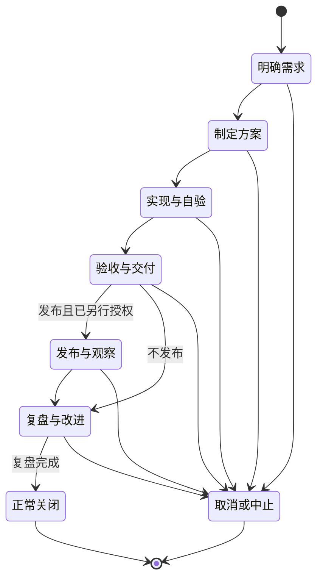
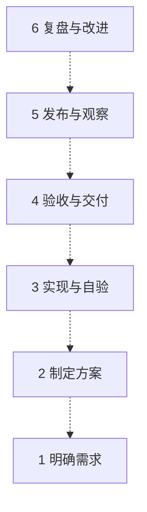
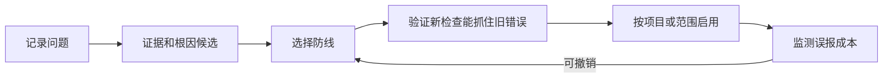
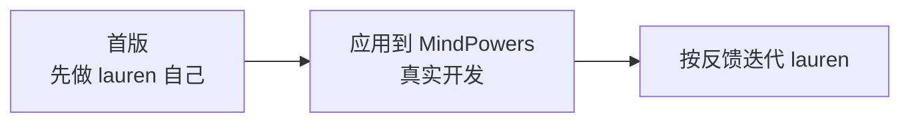
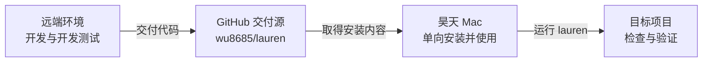
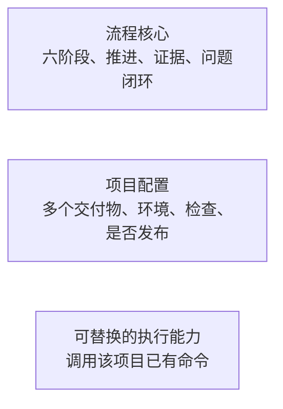

# 讨论记录

日期：2026-11-15。同日补充了产品路线、首个真实使用项目的背景，以及开发与使用环境的已确认约束。

本文记录讨论，不转述 [Lauren Tan 的演讲](https://ai.engineer/code/2026/talks/lauren-tan)，也不记载插件安装方法。v0.1 的可运行实现和它暂时选定的行为见 [v0.1.md](v0.1.md)。那些选择只约束这一版，下面的待讨论项没有因此永久冻结。

## 怎样读状态

| 标记 | 含义 |
| --- | --- |
| 已修订 | 讨论中出现过，已被最新讨论替换。不再当作当前暂定 |
| 已暂定 | 当前用来继续讨论的工作约定。可以再改，不是冻结规格 |
| 用户确认方向 | 用户已经明确的设计方向 |
| 已确认约束 | 用户明确要求后续遵守的环境或交付约定。未决的机制不放在这里 |
| 提案 | 为实现上述方向写下的设想。尚未确认，也未实现 |
| 待讨论 | 本文不替它做选择 |

下文不使用「当前共识」称呼任何一条。

## 项目目标

- 做一套个人使用的 coding 质量插件，在 Codex 和 Claude Code 里都能用，包含代码和 Skill。
- 跟踪的单位是一次有明确目标的变更。这次变更可以跨多次会话，直到它结束。
- 安装这个插件的人和 agent 都能看出：变更走到哪一步、正在做什么、哪些检查还没过、为什么停住、下一步可以做什么。
- 问题从发现记到处置去向。能收成检查的，用代码化流程拦住；Skill 负责引导。
- 第 4 步验收和第 5 步发布观察要能随交付物和运行环境扩展。真实场景用来决定流程和扩展接口留出哪些差别；通用机制等使用验证之后再提炼。做出产品的顺序见「产品路线」。

## 非目标

- 讨论记录不代替程序。可运行的 v0.1 在仓库的 CLI 里，见 [v0.1.md](v0.1.md)。不自动合并，不发布。
- 插件和 hooks 可以关掉，不把它们当作安全边界。仓库 CI 才是合并门禁。
- agent 不为了通过而自行豁免检查，也不修改验收标准。
- 进入某个阶段、检查通过、交付被接受、已经发布，是四件不同的事。发布要另行授权。
- 流程核心不内置 Web、微服务或某一种部署技术的专用步骤。
- 首版不建通用动态插件系统，也不预先定义复杂的 adapter 协议。
- 某一个项目的验收命令、观察方式或教训，不自动变成所有项目的规则。
- 不显示伪精确的完成百分比。
- 本文不决定存储格式、实现语言、命令字面和权限审批机制。
- 不修改 MindPowers，也不在本仓库集成它。
- 不把 MindPowers 试点做完当作 lauren 首版的开发前提。
- 不把 lauren 自身跑通基础闭环写成 MindPowers 的实践反馈。
- 不编造 MindPowers 的技术栈、仓库布局、目录或具体命令。本文没有访问该项目。
- 不把昊天 Mac 当作 lauren 的开发源或提交源，不在 Mac 上修改 lauren 源码后推送。
- 不把这条环境约定写成禁止在 Mac 上运行 lauren，或禁止对目标项目做检查、验证和运行时验收。
- 不规定更新、安装、版本选择和签名或校验方式，也不假设用 git reset 覆盖本机内容，或自动拉取 main。

## 生命周期单位

已暂定：一次变更对应一个明确目标。它不是一轮对话，不是一次 agent 运行，也不是一个 commit。中途换会话可以继续同一次变更。

一次变更有两种结束结果：

- 正常关闭：走完这次变更适用的阶段，并且第 6 步复盘完成。
- 取消或中止：单独记下这个结果。不把它写成正常关闭，也不把它写成成功交付。

## 六个阶段

已暂定的阶段名称：

1. 明确需求
2. 制定方案
3. 实现与自验
4. 验收与交付
5. 发布与观察（可选）
6. 复盘与改进

各阶段要做的事：

1. 把这次变更的需求、验收规格和项目基线合在一处，写清要满足什么。
2. 写下实现方案、风险，以及动手之前的验证计划。
3. 实现变更，并完成这次约定的自验。
4. 按验收规格核对交付。具体做法随交付物和运行环境变化，见「用户确认方向」。检查通过本身还不等于交付被接受。
5. 仅在这次要发布、且发布已另行授权时进入。观察什么、怎样观察，也随环境变化。
6. 显式收尾。统一核对问题处置、已经验证生效的防线、后续待办和适用范围。长期改进可以留在待办中。核对完成之后，变更才正常关闭。

前进路径，已暂定：

- 不发布：第 4 步直接进入第 6 步。
- 发布：第 4 步进入第 5 步，再进入第 6 步。
- 正常关闭只发生在第 6 步完成之后。

阻塞和暂停不在这张图里。它们不改变阶段：阻塞表示缺条件，暂停表示人先停住。取消或中止会结束变更，并使用上面的单独结果。

风险低的变更可以少留产物，也不要求每个阶段都由人批准一次。可以省略哪些产物，还没有规定。

### 曾出现的五阶段表述

已修订，不再使用：

> 只有五个阶段。质量改进循环贯穿所有阶段，不是第六阶段。

最新讨论改为六个阶段。质量上的问题在任何阶段都可以记录，这条贯穿记录保留。它不能代替第 6 步的显式收尾。

### 回退

回退和取消不是一回事，也不是把结果改成通过。哪些回退边合法，尚未暂定。下面的虚线只表示「申请回到紧邻的前一阶段」这一组候选，供以后取舍。第 5 步之后能否回退、第 6 步发现缺口时能回到哪里、能否跨过中间阶段，都还没定。没画出来的边，既不算已经允许，也不算已经禁止。

已经明确排除的做法放在 CLI 提案里：不提供直接设置阶段的操作，也不允许把检查填成通过。那是提案的能力边界，不是一张已经确认的回退图。

## 贯穿全程的质量反馈

已暂定：任何阶段都可以记录问题。记录按下面的顺序往下走。

选择防线时的顺序，已暂定：

1. 优先改架构或 API，让错误难以写出来。
2. 其次用 lint、类型、测试或 CI 拦住。
3. 最后才依赖文字规则。

每个问题都要有处置去向。去向写明即可，本轮不必把所有长期改进做完。已经验证生效的检查按项目或更小范围启用，并继续看误报成本，可以撤销。

这条循环不产生新的阶段。随手记下的问题和教训，也不能代替第 6 步。

第 6 步要放在一起核对的内容：

- 每个问题的处置去向
- 哪些防线已经验证能抓住旧错误，并已生效
- 留给以后的待办
- 每条结论的适用范围

## 产品路线

用户确认的顺序是：

1. 先开发 lauren 自己的首版。
2. 再把这个首版应用到 MindPowers 的真实开发。
3. 之后按使用反馈迭代 lauren。MindPowers 后续功能开发继续进行时，lauren 也继续迭代。这一步在应用之后。

当前另有一份对 MindPowers 的只读参考，角色是首版的需求输入。核对到的事实可以稍后补进本文。这份参考不改为先集成或改造 MindPowers。MindPowers 试点做完与否，不作为开始开发首版的前提。

首版要有的能力：六阶段 CLI 的状态、门禁、检查执行、证据和进度查询，以及 Skill 引导。每一项的具体范围仍待讨论。命令字面和数据对象仍见后文提案。

首版可以在 lauren 自己的变更上验证基础闭环。该结果只说明 lauren 自身跑过，不能当作 MindPowers 的实践反馈。

首个真实使用项目，按用户指定，是「昊天 Mac」上 Codex 中的 mindpowers-server。用户描述其中包含 mindpowers-server 后端、MindPowers CLI、mindpowers-fe 前端等类型。这是用户提供的背景，尚未经仓库事实核实。本文不据此补写技术栈、是否为 monorepo、目录或具体命令。昊天 Mac 在这里是使用现场，不是 lauren 的开发或提交源，见「开发与使用环境」。

用这类真实场景推动流程和扩展接口：不同交付物的验收、发布和观察要能分开。跨场景验证之后，再考虑提炼通用机制。当前不为此先定通用动态插件系统或 adapter 协议。首个试点覆盖 MindPowers 的哪一部分，等只读分析之后再定。

在 lauren 自身验证基础闭环，属于远端的开发测试，代码仍交付到下面的 GitHub 仓库。这和日后在昊天 Mac 上运行 lauren、对目标项目做检查，是两件场合。

## 开发与使用环境

以下是已确认约束。更新和安装的具体做法不在这些约束里。

lauren 的后续开发放在远端。开发和开发测试都在远端做。项目代码交付到 [https://github.com/wu8685/lauren](https://github.com/wu8685/lauren)。GitHub 是 lauren 的交付源。

昊天 Mac 是工作机。它只单向取得 lauren 的最新内容，用来安装和使用。它不是 lauren 的开发源，也不是提交源。不在 Mac 上修改 lauren 源码后再推送。

Mac 上的使用包括运行 lauren，以及执行面向目标项目的检查和验证，其中包含运行时验收。源码不从 Mac 开发和推送。运行 lauren，以及对目标项目做检查和运行时验收，都留在使用范围内。

更新用什么机制、安装哪一个版本、要不要签名或校验，都还没有定。本文不假设必须用 git reset 覆盖本机已有内容，也不假设自动拉取 main。

提案，用户尚未确认具体存储方案：本机的运行配置、任务状态和证据，与安装下来的 lauren 代码分开存放，避免一次更新把它们覆盖掉。分开这件事是建议。放到哪、用什么格式，都未定。

## 可扩展、场景差异、渐进演化

### 用户确认方向

用户已经确认三件事：

- 可扩展。后来出现的新交付物、新环境，要能加进来。
- 场景相关。尤其是第 4 步验收与交付、第 5 步发布与观察。它们依赖具体交付物和运行环境，做法不同。例如 CLI 和微服务就不是同一套验收。
- 渐进演化。初期不必覆盖所有形态。先有 lauren 首版，再进入 MindPowers 的真实使用，然后按反馈补充。顺序见「产品路线」。

同一次说明里，用户还规定了教训和规则的适用范围：

- 项目特有的教训留在该项目。
- 一条做法要在多个场景里验证过，再考虑收成通用能力。
- 单个项目的规则不自动变成全局规则。

「按项目或范围启用检查」与这条方向一致：启用范围写在该项目或该次变更上，不因一次使用就扩大到所有项目。MindPowers 上以后得到的教训，在被其他场景验证之前，留在 MindPowers，不自动变成 lauren 的全局规则。用户描述的后端、CLI、前端只说明交付物类型可能不同，不表示这些部分的运行方式已经核实。

### 提案：三块分开

下面是提案，用来落实上面的方向。用户还没有确认这套拆分。

三块彼此分开：

- 流程核心保住阶段、推进条件、证据和问题闭环。这里的六阶段和问题闭环沿用上文已暂定的内容。提案只是把它们放在核心里，不放进某一种技术的专用步骤。
- 项目配置描述这一次具体怎么验、发不发布。它可以包含多个交付物、多个环境、多项检查，以及这次要不要发布。配置的文件格式未定。
- 执行能力负责真正跑检查。它应该可以替换。提案里的做法是复用该项目已经有的脚本或命令，把这次运行的结果和证据收成统一的检查记录。在 lauren 自身验证基础闭环时，命令来自 lauren；以后用到 MindPowers 时，命令来自 MindPowers。本文不列出那些命令。这里不建通用动态插件系统。

流程核心不写死 Web、微服务或具体部署技术。这些差异放在项目配置和要执行的命令里。

当前提案不包含通用动态插件系统，也不定义 adapter 协议。讨论里曾把「不同技术栈用 adapter 调用已有检查」当作一种接法。按最新要求，那不是首版要做的事，也不进入当前提案。以后若真实使用表明现有命令不够用，再另议，不在本文预先规定接口。

配置里的「要不要发布」用来选择第 4 步之后走第 6 步，还是走第 5 步。它不代替「发布另行授权」。授权怎样记录，仍待讨论。

### 例子，不是必备清单

这些只说明场景可以不同。某个项目没有的项，就不必做。

- CLI 的验收可以包括安装、输出和退出码。
- 微服务的验收可以包括接口、健康检查和依赖失败时的表现。
- 发布与观察同样按该环境来，不共用一份观察清单。

一个变更里若有多个交付物或环境，第 4 步和第 5 步按它们分别记录。是否必须全部通过才能推进，还没有规定。

## 质量边界

已暂定：

- Skill 负责引导。大部分保障来自代码化的确定性流程，例如检查、证据和阶段条件。
- 阶段推进需要被管控，避免人和 agent 偏离已暂定的路径。安装者和 agent 都要能查看进展。首版里程碑包含承担状态、门禁、检查执行、证据和进度查询的 CLI，以及 Skill 引导。具体范围待讨论。命令形态和数据对象仍是后文提案。
- 仓库 CI 是合并门禁。插件或 hooks 可以被关掉，所以它们不是安全边界。
- agent 不能自行豁免必过检查，也不能改验收标准来换通过。
- 人位于某一阶段，只说明工作进行到这里。阶段本身不是「通过」。
- 检查通过，不等于交付已经被接受，也不等于已经发布。
- 证据绑定产生它的代码、环境和配置。这些相关对象变了，证据失效，不能再当作通过。失效之后是停住重跑，还是回退阶段，待讨论。
- 阻塞、暂停、取消与阶段分开。

## 决策记录

### 已修订

| 编号 | 结论 |
| --- | --- |
| R1 | 五阶段，以及「质量改进循环贯穿所有阶段，不是第六阶段」，已被最新讨论修订。当前暂定见 T2、T5、T8 |

### 已暂定

| 编号 | 结论 |
| --- | --- |
| T1 | 生命周期单位是一次有明确目标的变更，可跨会话 |
| T2 | 六个阶段的名称，以及不发布时 4→6、发布时 4→5→6、复盘完成后才正常关闭 |
| T3 | 取消或中止单独记录，不写成正常关闭或成功 |
| T4 | 阻塞、暂停不改变阶段；取消才结束变更 |
| T5 | 问题可在任一阶段记录：证据和根因候选，再选择防线，验证能抓住旧错误，按项目或范围启用，监测误报并可撤销 |
| T6 | 防线顺序：架构或 API，然后 lint、类型、测试、CI，最后是文字规则 |
| T7 | 每个问题有处置去向。长期改进未做完时，本轮仍可在第 6 步关闭 |
| T8 | 第 6 步核对问题处置、已验证生效的防线、后续待办、适用范围。贯穿记录不能代替这一步 |
| T9 | Skill 引导；大部分保障来自确定性流程 |
| T10 | 仓库 CI 是合并门禁。插件和 hooks 可关，不是安全边界 |
| T11 | agent 不能自行豁免检查，也不能修改验收标准 |
| T12 | 阶段、检查通过、交付被接受、已发布，彼此分开。发布另行授权 |
| T13 | 证据绑定代码、环境和配置；相关变更后失效 |
| T14 | 风险低时可以简化产物，不强制每阶段人工批准 |

### 用户确认方向

| 编号 | 结论 |
| --- | --- |
| U1 | 可扩展 |
| U2 | 场景相关。第 4 步和第 5 步取决于交付物和运行环境，方式不同 |
| U3 | 渐进演化。初期不求全面。顺序是 lauren 首版、MindPowers 真实使用、再按反馈迭代 |
| U4 | 项目特有教训留在项目。跨场景验证之后再考虑提炼为通用能力。单个项目的规则不自动全局化 |
| U5 | 路线：先做 lauren 首版，再应用到 MindPowers 真实开发，再按反馈迭代 lauren |
| U6 | 只读参考 MindPowers 是首版需求输入。不先集成或改造 MindPowers。完成该试点不是首版开发前提 |
| U7 | 首个真实使用项目是用户「昊天mac」上 Codex 的 mindpowers-server。用户描述含 mindpowers-server 后端、MindPowers CLI、mindpowers-fe 前端等类型。未经仓库事实核实 |
| U8 | 用真实场景驱动流程与扩展接口，再提炼通用机制。首个试点范围待只读分析后确定 |
| U9 | 首版能力：六阶段 CLI 状态、门禁、检查执行、证据、进度查询，以及 Skill 引导。具体范围待讨论。可在 lauren 自身验证基础闭环，不能冒充 MindPowers 实践反馈 |

### 已确认约束

| 编号 | 结论 |
| --- | --- |
| C1 | lauren 后续开发与开发测试在远端进行。项目代码交付到 https://github.com/wu8685/lauren。GitHub 是交付源 |
| C2 | 昊天 Mac 只单向取得 lauren 最新内容来安装使用。它不是开发源或提交源。不在 Mac 修改 lauren 源码后推送 |
| C3 | Mac 使用时可以运行 lauren，并执行面向目标项目的检查、验证和运行时验收 |

### 已确认：v0.1 配置、policy 与环境

这些是实现时锁定的做法，程序按这个做。

| 编号 | 结论 |
| --- | --- |
| C4 | `lauren.project.json` 只放共享的 environments、defaults、checks、requirements。没有 profile，也没有顶层的 environment / release 布尔 |
| C5 | 创建变更时把 defaults 拷成该变更的 policy。之后门禁以 policy 为准。`change policy set` 要有理由并写入历史 |
| C6 | `release_stage` 是 included 或 excluded。`artifact_level` 是 standard 或 abbreviated。`integration_intent` 可以是 branch，或 not_in_current_iteration |
| C7 | 检查字段是 gate，不是 when。取值 self_verification、acceptance、release。release_readback 是层次名 |
| C8 | 运行状态按 `.lauren/runtime/changes/<id>/` 分开。同一工作区同时只有一个进行中的变更；不同 worktree 可以各自有一个 |
| C9 | 每次检查记下实际环境。门禁要的是当前候选上、环境被该检查接受的有效通过。改默认环境不废除另一个环境里仍然有效的证据 |
| C10 | 验收失败回到实现与自验。发布读回失败同样回到实现与自验，不自动部署或撤回。进入共享环境发布前要先记录合入 integration_branch 的 SHA |
| C11 | 已合入且未撤回时不能只改集成分支。暂不纳入当前迭代时不能占用当前共享预发或生产。改 defaults 不废除已有证据；改 checks 或 requirements 会 |
| C12 | 问题在项目公共库 `.lauren/problems/<id>.json`，纳入 git，不跟单次变更绑定。一次反馈是一次 occurrence |
| C13 | 第六步按 title、layer、symptom 的确定性规则合并同类。`defaults.promote_threshold` 默认 2。一次不改 checks；达到阈值才晋升到 checks/requirements |
| C14 | `verified_fixed` 不能手填。同一检查要先有旧失败，再有仍然有效的通过。本轮问题没有处置完，复盘不能关闭 |
| C15 | 达到晋升阈值只登记到已有且层次足够的 target-check，不生成占位脚本。未登记不能用 later 结束复盘；只出现一次仍可以 later。新的一次出现不沿用旧处置和已验证结论 |
| C16 | 单项检查超时原先硬编码 120 秒，已改为默认 600 秒。`defaults.check_timeout_seconds` 是项目默认，检查上的 `timeout_seconds` 可覆盖；缺字段或 0 沿用上一级。改这个超时会作废已有检查证据。C11 里其他 defaults 仍不废除证据 |
| C17 | 同一检查、同一环境只认最新一条仍有效的结果。后来的失败、partial、blocked 或超时不能再靠更早的通过推进。其他环境和检查不互相覆盖。发布读回用同一规则 |
| C18 | 候选指纹改为 `fingerprint v2`，用 git 的 NUL 记录解析路径。读失败不再静默当成删除。旧算法留下的通过不能继续有效 |
| C19 | 启用发布阶段时，离开发布与观察必须有必过的 `release_readback`。声明、空检查集，或其他层次的 release 检查，都不能使 `release_verified` 为 true |
| C20 | `product_verified` 保留，含义是已配置要求有通过记录，不是独立验收。新增 `requirements_met`、`self_checks_met`、`acceptance_checks_met`、`independent_acceptance`、`acceptance_source`。`source_verified` 这一版恒为 false |
| C21 | 需要报告的 requirement 绑定 QA 报告的 sha256、候选指纹、环境和来源声明。摘要不符或文件缺失就不能过门禁。来源不会被自动标成已验证。报告默认在 `.lauren/reports/`，并且不计入 v2 候选指纹 |
| C22 | Red 门禁默认关闭，避免现有项目突然过不了实现阶段。`defaults.red_gate=required` 时，离开实现前要有脚本声明分类的先失败再通过，或带理由的 `change red skip`。程序不猜测分类。同一环境的最新失败仍然盖过更早的通过 |
| C23 | 创建变更时冻结当时的检查计划。必过项不能去掉，跳过可选项要有理由。过了明确需求，计划要先 propose，再由所有者 `confirm --owner-confirmed` 才生效，并作废相关证据。之后改项目 checks 不改已冻结的计划，也不改变 v2 指纹里这次计划的目录 |

### 提案

v0.1 已按 [v0.1.md](v0.1.md) 落地了其中一部分。下表仍表示讨论时的提案，不是永久规格。确认之前可以替换尚未写进程序的部分。

| 编号 | 结论 |
| --- | --- |
| P1 | 流程核心、项目配置、可替换的执行能力分开。核心含六阶段、推进、证据和问题闭环 |
| P2 | 核心不硬编码 Web、微服务或具体部署技术 |
| P3 | 执行能力复用该项目已有脚本命令，统一记下执行结果和证据。不建通用动态插件系统，不定义 adapter 协议。不在本文列出 MindPowers 或 lauren 的具体命令 |
| P4 | CLI 的安装、输出、退出码，以及微服务的接口、健康、依赖失败，只是验收例子。发布和观察也按环境适配 |
| P5 | 共享的流程核心可作为 Codex 与 Claude Code 唯一受支持的状态变更入口 |
| P6 | 命令按意图区分：创建变更、提交阶段产物、运行检查、申请推进、申请回退、查询状态、历史、阻塞、下一步、记录教训 |
| P7 | 引擎校验条件后再改状态。没有「把检查填成通过」，也没有「直接设置阶段」 |
| P8 | 输出同时给人读，并提供 JSON。内容见 CLI 一节。不给伪精确百分比 |
| P9 | Skill 不复制一套门禁判断 |
| P10 | 本地文件可以被改写。CLI 不能防止恶意篡改。信任边界是 CI 重跑，以及人的接受 |
| P11 | 独立 oracle 不等于换成另一个 agent |
| P12 | 建议本机运行配置、任务状态和证据与安装代码分开存放，避免更新覆盖。用户尚未确认具体存储方案 |

### 待讨论

| 编号 | 问题 |
| --- | --- |
| Q1 | 状态和证据的存储格式 |
| Q2 | 实现语言 |
| Q3 | 可执行文件名和命令字面 |
| Q4 | 权限和审批机制。其中包括发布授权如何记录，以及它和配置中的「是否发布」如何配合 |
| Q5 | 哪些回退边合法。证据失效后，是阻塞并重跑，还是回退到某一阶段 |
| Q6 | 低风险变更可以省略哪些产物 |
| Q7 | 第 5 步的观察做到什么程度可以离开 |
| Q8 | 第 6 步「复盘完成」里，哪些条件可以由机器核对，哪些必须人确认 |
| Q9 | 暂停和阻塞如何恢复。取消之后能否重开同一次变更 |
| Q10 | 项目配置写在哪里、有哪些字段 |
| Q11 | 多个交付物或环境同时存在时，推进是否要等全部必过检查 |
| Q12 | 统一的执行结果至少留下什么。目前只要求能表示检查状态和证据，字段未定 |
| Q13 | 一条教训要经过哪些场景，才值得收成通用能力 |
| Q14 | Codex 与 Claude Code 在首版里如何调用同一核心。不在本文规定宿主协议 |
| Q15 | 首版里状态、门禁、检查执行、证据、进度查询和 Skill 引导，各自做到哪一层 |
| Q16 | MindPowers 首个试点覆盖哪些部分。等只读分析后的事实再定，本文不预填 |
| Q17 | 更新与安装机制、版本选择、签名或校验方式。不假设强制 git reset 覆盖，也不假设自动拉取 main |

## CLI 设计提案

上面的 P1–P12 仍是讨论时的提案记录。命令字面和状态格式以现在的程序为准，见 [v0.1.md](v0.1.md)。这里不再保留一套未实现的命令示意。
